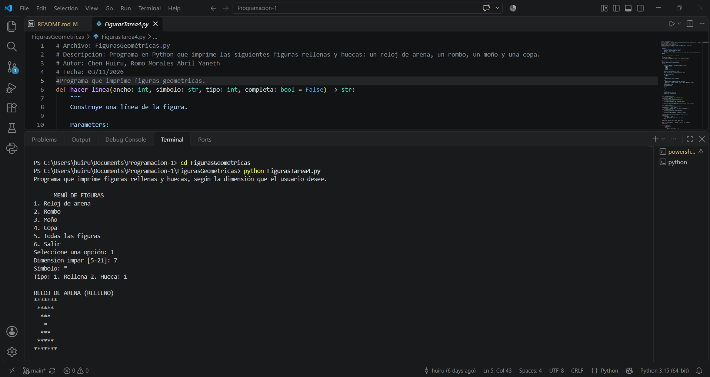

# Programación 1

Programas de Pseint y Python que hicimos en Programación en primer semestre de LCC.

Los ejercicios están organizados por temas , y cada programa se encuentra en su propia carpeta.

## Contenidos

| Programa | Descripción |
|---|---|
|'blackjack/' | Juego de BlackJack para un participante contra la banca (dealer o crupier). |
| 'curp_16.pcs' | Algoritmo que genera los primeros 16 caracteres de la CURP (Clave Única de Registro de Población). |
| 'FigurasTarea4.py' | Programa que imprime las siguientes figuras: reloj de arena, rombo, moño y copa, tanto rellenas como huecas. |
| 'Funciones_Contraseña.py' | Programa que utiliza para determinar si una contraseña es segura. |
| 'IndiceDeMasaCorporalAdultos.pcs' | Algoritmo que calcula el índice de masa corporal (IMC) de una persona adulta de al menos 20 años e indica su categoría de peso. |
| 'OperacionRescate.pcs' | Algoritmo que solicita la cantidad de estudiantes que se analizarán y captura las calificaciones obtenidas en los tres primeros exámenes de cada estudiante. |

## Requisitos

Tener la aplicación de pseudocódigo Pseint , en la configuración UNISON-LCC.
Tener instalado Visual Studio Code.
Tener instalado Python 3.

## Cómo ejecutar los programas

Cada programa debe ejecutar utilizando el lenguaje o entorno correspondiente a su archivo.

### Programas en Python

Para ejecutar 'FigurasTarea4.py' , abre una terminal en la carpeta del repositorio y utiliza el siguiente comando:

'''bash
python3 FigurasTareas4.py
'''

### Programas en PSeInt

Los archivos con extensión '.psc' se pueden abrir desde PSeInt para visualizar y ejecutar sus algoritmos.

### Juego de Blackjack 

Para ejecutar este programa, consulta la ubiccación y los archivos correspondiente dentro de sus carpetas. 

## Ejemplo de funcionamiento

### Juego de BlackJack

Este programa implementa una partida completa de **BlackJack** con interfaz gráfica desarrollada en `tkinter`. **Nota:** Este proyecto no imprime salida en consola ni recibe datos por teclado (`input`), ya que toda la interacción se realiza mediante botones y eventos gráficos en una ventana de `820 x 620` píxeles (más la barra inferior de controles).

Al ejecutar el programa, se abre la mesa de juego con fondo verde casino, el título **BLACKJACK**, los cuatro palos decorativos, un marco dorado y tres botones en la parte inferior: **Pedir carta**, **Plantarse** y **Nueva partida**.

**Ejemplo de entrada (interacción) y salida (visual en ventana):**

```text
=== VENTANA: BlackJack ===

DEALER                                           Puntos: 10 + ?
[ 10 ♥ ]   [ ♠ (oculta) ]

        ┌─────────────────────────────────────────────┐
        │ Tu turno: pide una carta o plántate         │
        └─────────────────────────────────────────────┘

JUGADOR                                          Puntos: 15
[ 9 ♣ ]    [ 6 ♦ ]

---------------------------------------------------------------
   [ Pedir carta ]     [ Plantarse ]     [ Nueva partida ]
---------------------------------------------------------------

Acción del usuario: Clic en [ Pedir carta ]
Carta repartida al jugador: ("8", "♠")

DEALER                                           Puntos: 10 + ?
[ 10 ♥ ]   [ ♠ (oculta) ]

        ┌─────────────────────────────────────────────┐
        │ Te pasaste de 21. Gana el dealer.           │
        └─────────────────────────────────────────────┘

JUGADOR                                          Puntos: 23
[ 9 ♣ ]    [ 6 ♦ ]    [ 8 ♠ ]
```

**Ejemplo de turno del dealer al plantarse:**

```text
Acción del usuario: Clic en [ Plantarse ]

DEALER                                           Puntos: 14
[ 10 ♥ ]   [ 4 ♠ ]

        ┌─────────────────────────────────────────────┐
        │ Turno del dealer...                         │
        └─────────────────────────────────────────────┘

JUGADOR                                          Puntos: 19
[ K ♣ ]    [ 9 ♦ ]

(El dealer destapa su segunda carta y pide cartas automáticamente cada 800 ms mientras tenga menos de 17 puntos)

DEALER                                           Puntos: 20
[ 10 ♥ ]   [ 4 ♠ ]    [ 6 ♦ ]

        ┌─────────────────────────────────────────────┐
        │ Gana el dealer. Tiene más puntos.           │
        └─────────────────────────────────────────────┘

JUGADOR                                          Puntos: 19
[ K ♣ ]    [ 9 ♦ ]
```

### Módulos de lógica (`logica/`)

La carpeta `logica/` (`mazo.py`, `puntos.py`, `juego.py`) no utiliza `tkinter` y se encarga de mezclar el mazo de 52 cartas, calcular los puntos (ajustando el valor del As de `11` a `1` si se pasa de 21) y determinar el ganador.

**Ejemplo de entrada y salida de funciones internas:**

```text
Mano ingresada: [("2", "♥"), ("7", "♥")]
Puntos calculados: 9

Mano ingresada: [("A", "♦"), ("9", "♣"), ("9", "♠")]
Puntos calculados: 19

Mano ingresada: [("A", "♣"), ("Q", "♠")]
Blackjack natural: True

Mano ingresada: [("A", "♦"), ("A", "♥")]
Blackjack natural: False
```

### Posibles resultados de la partida

```text
- jugador_blackjack -> "¡BlackJack natural! Ganas la partida."
- dealer_blackjack  -> "El dealer tiene BlackJack natural. Gana el dealer."
- empate_blackjack  -> "¡Empate! Ambos tienen BlackJack natural."
- jugador_pasa      -> "Te pasaste de 21. Gana el dealer."
- dealer_pasa       -> "El dealer se pasó de 21. ¡Ganas!"
- jugador_gana      -> "¡Ganas! Tienes más puntos que el dealer."
- dealer_gana       -> "Gana el dealer. Tiene más puntos."
- empate            -> "¡Empate! Misma puntuación."
```

### Generador de CURP
(`curp_16.psc`)

Este programa genera los primeros 16 caracteres de la CURP a partir de los datos ingresados por el usuario.

**Ejemplo de entrada y salida:**

```text
Algoritmo que genera 16 caracteres de la curp
Escribe los datos tal como aparecen en tu acta de nacimiento.
Nombre(s): Carla
Primer apellido: Meza
Segundo apellido (deja vacio si no tienes): Ruedas
Día de nacimiento (1-31): 9
Mes de nacimiento (1-12): 11
Año de nacimiento (<=2026): 2007
Sexo M (mujer), H (Hombre): M
Ingrese su entidad federativa de nacimiento: SONORA

Clave CURP: [resultado del programa]
```

### Figuras geométricas
(`FigurasTarea4.py`)

Al ejecutar `FigurasTarea4.py`, el programa muestra un menú donde se selecciona la figura, su dimensión, el símbolo y el tipo de figura.

**Ejemplo de entrada y salida:**

```text
===== MENÚ DE FIGURAS =====
1. Reloj de arena
2. Rombo
3. Moño
4. Copa
5. Todas las figuras
6. Salir
Seleccione una opción: 2
Dimensión impar [5-21]: 5
Símbolo: *
Tipo: 1. Rellena 2. Hueca: 1

ROMBO (RELLENO)
  *
 ***
*****
 ***
  *
```


### Validador de contraseña
(`Funciones_Contraseña.py`)

Este programa evalúa si una cadena ingresada contiene al menos una letra mayúscula, una minúscula, un número y un carácter especial[cite: 11].

**Ejemplo de entrada y salida:**

```text
Escribir la contraseña: Hola123!
Tu contraseña es segura
```

```text
Escribir la contraseña: 12345
La contraseña no es segura
```
# Comprueba que el dato ingresado sea valido


### Índice de masa corporal para adultos
(`ÍndiceDeMasaCorporalAdulto.psc`)

Este algoritmo solicita la edad, el peso y la estatura para calcular el IMC y mostrar la categoría correspondiente en adultos (edad mayor o igual a 20 años, peso mayor que 0 y estatura mayor que 0)[cite: 12].

**Ejemplo de entrada y salida:**

```text
Conocer la categoría de IMC a la que perteneces

IMC = Peso / Estatura^2

Escribir tu edad (años):25
Escribir tu peso (kg.):68
Escribir tu estatura (m.):1.70
Tu IMC es: 23.52941176470588
Su categoría corresponde a: Peso saludable
```

```text
Conocer la categoría de IMC a la que perteneces

IMC = Peso / Estatura^2

Escribir tu edad (años):18
Datos invalidos. Su edad debe ser mayor o igual a 20
```

### Operación rescate 
(`OperacionRescate.psc`)

Este algoritmo captura las calificaciones de tres exámenes (de `0` a `100`) para cada estudiante, calcula el promedio actual redondeado, indica cuánto necesita para promedios finales de `90` y `60`, clasifica su categoría y muestra el conteo final por categoría[cite: 13].

**Ejemplo de entrada y salida:**

```text
Algoritmo que evalua las calificaciones de los estudiantes para conocer si pueden aprobar y que tipo de estudiante son
Ingresar la cantidad de estudiantes: 1

Estudiante 1
Ingresar la calificación del examen 1 (0 ~ 100): 85
Ingresar la calificación del examen 2 (0 ~ 100): 90
Ingresar la calificación del examen 3 (0 ~ 100): 88

Promedio actual: 88
Para obtener un promedio final de 90 ocupas sacar: 97
Meta alcanzable
Para obtener un promedio final de 60 ocupas sacar: -23
Meta alcanzable
Categoría: Rendimiento regular potencial

Cantidad de estudiantes con posibilidad de obtener un promedio sobresaliente: 0
Cantidad de estudiantes con posibilidad de obtener un rendimiento regular: 1
Cantidad de estudiantes que pueden rescatar el semestre: 0
Cantidad de estudiantes que reprobarán inevitablemente: 0
```
## Cómo ejecutar el programa de figuras

## Ejecución de un programa

### Funciones de contraseña

1. Abre una terminal en la carpeta principal del repositorio.
2. Ejecuta el programa con:

   ```bash
   python FuncionContraseña/Funciones_Contraseña.py
   ```

3. Sigue las instrucciones que aparecen en pantalla.

## Autor
Chen Huiru
